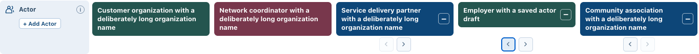

# Manual actor repositioning — Phase II

27 November 2026. Implemented locally; no commit or deployment performed.

Additional Customer and Other actors now have compact paired chevrons immediately below their names. Each press moves the complete actor one column. The first Customer and Orchestrator have no controls; the third actor cannot move left and the final actor cannot move right. With three actors both chevrons are disabled; with two there are none. Disabled controls keep their places. Native buttons provide named tooltips, keyboard activation and touch targets, with hover/focus styling. Controls align across different name lengths and preserve horizontal scrolling. Read-only and export rendering contain neither controls nor reserved space.



`moveActor()` resolves the stable actor ID, validates direction and boundaries, and splices the complete actor object within the actual `actors` array. There is no separate ordering property, sorting, schema change or ID regeneration. Normalization already preserves this order. All actor rows already use actor IDs as React keys. Types, colors, every actor attribute (including unknown extension attributes), process participation arrays and Process Canvas associations remain attached to their original IDs. New actors still append; removal, reclassification and the ten-actor limit retain their existing behavior.

Actor name, value-proposition and item editors keep their component identities when columns move. Tests hold open name and KPI drafts across movement and commit them to the correct actor afterward. Type menus close when focus/pointer interaction leaves them; their identities remain actor-based. Because `processListRevision()` includes ordered actor IDs/names, local movement is temporarily disabled while any process rename/add draft is open. A visible explanation and disabled-button tooltips say “Finish or cancel the process edit before moving actors.” Multiple concurrent process drafts and failed commits keep this restriction until every draft closes. Other editing remains available.

Revision checking is unchanged. An external reorder can still invalidate a process draft; the existing notice explicitly reports cancellation of uncommitted edits, and the mutator rejects a stale commit. This existing behavior does not recover the cancelled text. No draft recovery or revision/concurrency redesign was introduced.

Movement uses `updateBlueprint()`, its latest-snapshot ref, no-op JSON comparison, and the existing page `onChange` handler. Array order changes the saved hash and starts the existing 1200 ms autosave. Several moves and unrelated edits within the debounce save together. Pending saves disable the buttons and their synchronous lock prevents clicks arriving before disabled rendering. Successful saves/reopening preserve exact actor order. Ordinary failures retain local ordering; stale saves retain the existing visible conflict/reload behavior, which can discard local committed changes in favor of the server version. No automatic merge, retry or local recovery was added.

`CBMXData.ts`, `EditorPage.tsx`, normalization, import/export helpers and database objects needed no changes. The existing versioned RPC stores the supplied complete JSON. Disposable PostgreSQL checks confirm owner/editor saving, viewer rejection, stale-version rejection, unrelated concurrent edits, unchanged links/canvases and process deletion after reordering. These tests use incomplete local fixtures; live Supabase configuration, schema, RPCs, RLS and records were neither accessed nor changed.

Production JSON export/import handlers were exercised with reordered multi-customer blueprints: actor sequence, IDs, attributes and participant references round-trip, then remain movable. Existing single-customer import tests also pass. Import retains its existing process-ID/link-verification behavior; this enhancement does not bypass that machinery.

Validation results:

- Node 20 full suite: **342 passed, zero failed/skipped/TODO**. Includes mutation, rendering, simultaneous events, draft safety, autosave, reopening, permissions, JSON handlers and existing conflict/link/deletion regressions.
- TypeScript: `tsc -b` passed. Production build passed; the existing large-chunk warning remains.
- Lint: **37 errors and 4 warnings**, matching the captured pre-change baseline. Only a line-number shift in `CBMXTable.tsx`; no new issues or unrelated lint fixes.
- Real Chrome/Chromium 158.0.8127.37 and Playwright WebKit 26.0: **eight cases passed** (2, 3, 5 and 10 actors per engine), zero page errors. Checks include boundaries, complete actor rows, mixed roles, Enter/Space, touch, actor/process drafts, 400 px horizontal scrolling, alignment and read-only views.
- Actual PNG/PDF capture: eight generated pairs, including reordered five/ten-actor dense matrices. Both the independent export table and serialized raster clone retain the intended actor/content sequence. No controls, reserved positioning space or extra modeling rows enter exports. Labels remain complete and single-line with `white-space: nowrap; overflow-wrap: normal; word-break: normal`.
- PDF/PNG inspection: complete image edges/margins, exact embedded raster pixels, proportional fitting and one landscape A4 page verified; rendered PDF pages reviewed visually. Export dimensions, scaling and PDF helper are unchanged. Dense blueprints retain the existing single-page legibility/canvas-size limits.
- Disposable PostgreSQL: new movement suite **7 checks**; existing multi-customer **7**, process-link **18**, process-deletion **15** checks passed. No hosted testing was performed.
- Native macOS Safari 27.2 could not create a WebDriver session because “Allow remote automation” is disabled. No Safari setting was changed. Manual native Safari PNG/PDF verification remains required; WebKit is not a substitute for that sign-off.

Changed production files:

- `src/components/cbmx/cbmxMutators.ts`: guarded stable-ID `moveActor()`.
- `src/components/cbmx/CBMXTable.tsx`: controls, process-draft restriction, contextual help.
- `src/components/cbmx/cbmx.css`: compact aligned buttons, hover/focus/disabled states and notice.
- `src/components/cbmx/ui/CBMXActionIcon.tsx`: two chevrons in the existing icon system.
- `src/components/cbmx/ui/ItemList.tsx`: optional aggregate draft-state callback, used by the process list.

Changed tests: `tests/cbmxActors.test.mjs` and `tests/autosaveReliability.test.mjs`.

New files: this report; `review/cbmx/verify-actor-repositioning.mjs` (offline browser runner); `review/cbmx/inspect-actor-repositioning.py` (PNG/PDF inspection and rendering); `supabase/tests/run-actor-repositioning-tests.mjs` (in-memory database checks); `review/cbmx/evidence/actor-repositioning-controls.png` and `review/cbmx/evidence/actor-repositioning-checks.json` (compact retained evidence).

Regenerable actual captures and rendered PDFs are in ignored `output/cbmx-actor-repositioning-final/`. Example [Chromium PNG](../output/cbmx-actor-repositioning-final/chromium-5-reordered.png), [Chromium PDF](../output/cbmx-actor-repositioning-final/chromium-5-reordered.pdf), [WebKit PNG](../output/cbmx-actor-repositioning-final/webkit-5-reordered.png), [WebKit PDF](../output/cbmx-actor-repositioning-final/webkit-5-reordered.pdf).

Reproduce browser checks with the existing database-free preview running and an externally installed Playwright module:

```sh
PLAYWRIGHT_BROWSERS_PATH=/path/to/browsers node review/cbmx/verify-actor-repositioning.mjs --playwright=/path/to/playwright/index.mjs --engine=chromium --out=output/cbmx-actor-repositioning-final
PLAYWRIGHT_BROWSERS_PATH=/path/to/browsers node review/cbmx/verify-actor-repositioning.mjs --playwright=/path/to/playwright/index.mjs --engine=webkit --out=output/cbmx-actor-repositioning-final
python3 review/cbmx/inspect-actor-repositioning.py output/cbmx-actor-repositioning-final
node supabase/tests/run-actor-repositioning-tests.mjs --pglite-module=/path/to/@electric-sql/pglite/dist/index.js
```

The inspector uses external Pillow, pypdf with `apply_configuration`, and Poppler. No application dependency was added. Use a fresh output directory for a new browser run; records append to `browser-results.jsonl`.
